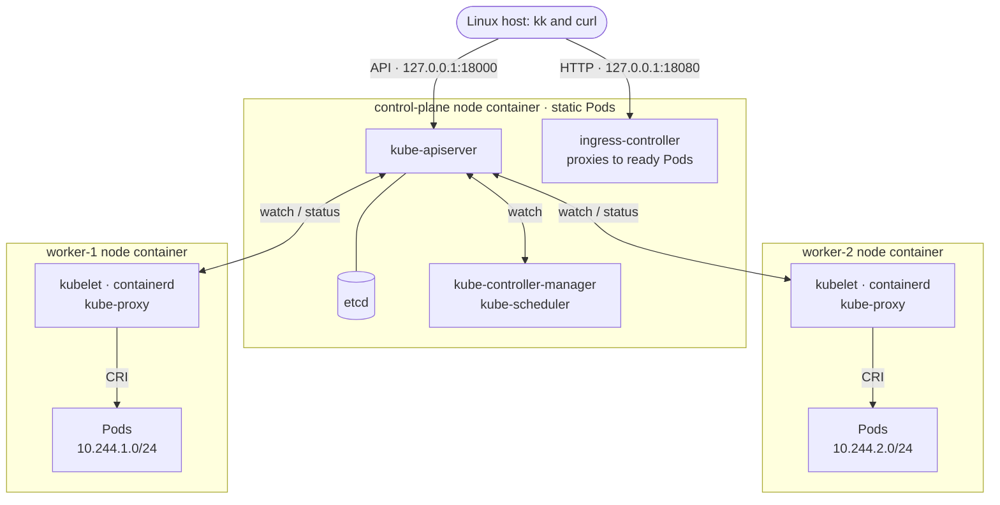

# mini-k8s

**English** | [简体中文](README.zh-CN.md)

mini-k8s is a compact Kubernetes written from scratch in Go. It implements its own
API server, scheduler, controller manager, kubelet, kube-proxy, CNI plugin, Ingress
controller and a CLI
called **`kk`**, reusing only etcd for storage, containerd as the container runtime and a
local Docker Engine to host the cluster's "machines".

The goal is "small but complete": the core Kubernetes mechanisms — declarative API,
watch, control loops, scheduling, node agent and cascading deletion — implemented in
as little code as possible, end to end and observable. It is not a wrapper around a
Kubernetes distribution, it is not `kubectl`-compatible, and it is not for production.

## What it does

- **Kubernetes-style API**: `/api/v1/namespaces/{ns}/pods`, `/apis/apps/v1/...`, objects
  with `metadata`/`spec`/`status`, errors as `Status` objects, discovery endpoints.
- **API machinery**: namespaces; UIDs and `resourceVersion` optimistic concurrency;
  `generation`/`observedGeneration`; `generateName`; strict decoding (unknown fields are
  errors); JSON merge patch; `dryRun`; label and field selectors; **watch** (streamed
  from etcd watches; objects leaving a selector are reported as DELETED).
- **Deletion semantics**: finalizers; graceful Pod termination (SIGTERM, then SIGKILL
  after the grace period); force deletion; ownerReferences and garbage collection with
  Background / Foreground / Orphan propagation; deleting a Namespace deletes its contents.
- **Control plane**: event-driven informers and work queues; Deployment and ReplicaSet
  controllers (RollingUpdate with `maxSurge`/`maxUnavailable` or Recreate, revision
  history, rollback, pause/resume, Available/Progressing conditions with a progress
  deadline); Endpoints controller; garbage collector; namespace controller.
- **Scheduler**: a kube-scheduler-style framework. Filter plugins check cordoned nodes,
  taints, `nodeSelector` and node affinity, resource requests against allocatable, and pod
  affinity/anti-affinity. Score plugins (with kube-scheduler's weights) prefer the least
  allocated node, spread a controller's replicas, and follow preferred affinities and
  PreferNoSchedule taints. Unschedulable Pods get kube-scheduler's messages (`0/3 nodes are
  available: 2 Insufficient cpu, …`), back off and are retried on cluster events; bindings go
  through the `binding` subresource.
- **Node lifecycle**: kubelets renew a Lease in `kube-node-lease`; when one stops, the node
  lifecycle controller marks the node Unknown, taints it `node.kubernetes.io/unreachable`
  and takes its Pods out of Services; the taint-eviction controller evicts Pods once their
  `tolerationSeconds` run out (300 s by default, as every Pod gets the default
  tolerations); NoExecute taints evict untolerating Pods; the `pods/eviction` subresource
  and `kk cordon/uncordon/drain/taint` maintain nodes.
- **Self-hosted like kubeadm**: etcd, kube-apiserver, kube-controller-manager,
  kube-scheduler and the Ingress controller are **static Pods** of the `control-plane`
  node, and kube-proxy is a static Pod of every node, all visible as mirror Pods in
  `kube-system`; the control-plane node is tainted so workloads stay on the workers; a
  crashed component is restarted by the kubelet.
- **Nodes like kind**: each node is a privileged container running its own containerd;
  the kubelet manages Pods over **CRI** (a sandbox per Pod, then its container);
  Ready only when the runtime, the Pod network and the sandbox image are ready.
- **Pods**: several containers sharing one network namespace; init containers that run
  one after another to completion; `restartPolicy` Always/OnFailure/Never with the
  Succeeded/Failed phases and the Initialized/ContainersReady/Ready conditions computed
  like the Kubernetes kubelet; liveness, readiness and startup probes (httpGet,
  tcpSocket, exec); CPU and memory requests/limits enforced through cgroups (`OOMKilled`)
  and QoS classes; `emptyDir` (disk or memory) and `hostPath` volumes; `hostNetwork`;
  `kk exec` runs commands in containers.
- **kubelet**: node registration, Lease renewal and status reports; static Pods from a manifest directory
  with mirror Pods; one worker per Pod; restarts with backoff (CrashLoopBackOff);
  `imagePullPolicy` and image pull errors (ErrImagePull/ImagePullBackOff); sandbox
  recreation after a node restart; logs with follow/tail/`--previous`; orphan cleanup;
  each Pod's resolv.conf from its `dnsPolicy`/`dnsConfig`, a managed `/etc/hosts`
  (`hostname`, `subdomain`) and the Service environment variables (`WEB_SERVICE_HOST`, …).
- **Pod network**: the node IPAM controller gives every node a `/24` from `10.244.0.0/16`;
  a home-grown CNI plugin (`mini-cni`: bridge, veth, IP allocation) wires each Pod; a
  host-gw route agent connects the nodes' Pod subnets, so Pods reach each other across
  nodes without NAT; Pods resolve names and reach the outside world through their node.
- **Services**: the API server allocates cluster IPs from `10.96.0.0/12` and node ports
  from `30000-32767`; the Endpoints controller tracks ready and unready Pods (named target
  ports, several ports); **kube-proxy** programs iptables like the real one's iptables mode
  (`KUBE-SERVICES` → `KUBE-SVC-*` → `KUBE-SEP-*`, random balancing, ClientIP session
  affinity, masquerading for NodePort and hairpin traffic, immediate rejection without
  endpoints); NodePort Services answer on every node; headless and ExternalName Services;
  the API server keeps the `kubernetes` Service, through which Pods reach the API.
- **Cluster DNS**: a home-grown DNS server (`kube-dns` on `10.96.0.10`, the role CoreDNS
  plays) answers `<svc>.<ns>.svc.cluster.local`, headless endpoints by hostname, SRV
  records, ExternalName CNAMEs and Pod records, and forwards everything else to the node's
  resolver.
- **Ingress**: an Ingress controller on `127.0.0.1:18080` routes by host (exact or
  wildcard) and path (Exact or Prefix) to the ready endpoints of Services, with a default
  backend, 404/503 answers and the address published in the Ingress status.
- **Observability**: Events (identical events aggregated with a count, expired after one
  hour by an etcd lease); `kk describe` shows an object's events.
- **kk**: `get` (`-o wide|json|yaml|name`, `-l`, `--field-selector`, `-A`, `-w`),
  `describe`, `apply`/`create` (server-side dry run of the whole batch first), `delete`
  (`--grace-period`, `--force`, `--cascade`), `logs -f/-p/-c`, `exec`, `scale`, `rollout status|history|undo|pause|resume|restart`, `cordon`/`uncordon`/`drain`/`taint`, `label`, `api-resources`,
  `version`, cluster lifecycle and `image load` (copy local images into the nodes).



How to read it:

- Each box is a privileged Docker container that plays a machine; the three share the
  Docker network `mini-k8s`.
- The control-plane node's kubelet runs etcd, the API server, the controller manager, the
  scheduler and the Ingress controller as static Pods; the node's taint keeps workloads on
  the workers. Every node (the control-plane one too) also runs kube-proxy; the cluster
  DNS (`kube-dns`, `10.96.0.10`) runs as ordinary Pods on the workers.
- Arrows between components are API traffic: every component lists and watches the API
  server and writes back; only the API server talks to etcd. The kubelet starts Pods through
  containerd (CRI).
- The Ingress controller forwards requests on `127.0.0.1:18080` straight to the ready Pods
  on the workers. Pods on different nodes reach each other directly over host-gw routes; cluster IPs
  (`10.96.0.0/12`) exist only as kube-proxy's iptables rules on each node, and node ports
  answer on every node's address.

Every component is a role of the single `mini` binary. Docker Compose only starts the
three node containers (like [kind](https://kind.sigs.k8s.io) nodes); as with kubeadm, each
kubelet starts its static Pods from a manifest directory before the API exists
([build/manifests/control-plane](build/manifests/control-plane),
[build/manifests/node](build/manifests/node) on the workers). Pods run in the nodes'
containerd, so the host's `docker ps` shows only the three nodes.

## What is built here and what is reused

The split mirrors the Kubernetes project itself: everything Kubernetes implements is
written from scratch here; what Kubernetes delegates to other projects (storage, the
container runtime) uses those open-source components as-is, configured but not modified.

**Built here** (Go, all in this repository):

| Component | Responsibility | Status |
| --- | --- | --- |
| kube-apiserver | Kubernetes-style REST, watch, admission and validation, deletion semantics, subresources, cluster IP and node port allocation | done |
| controller-manager | Deployment, ReplicaSet, Endpoints, garbage collector, namespace, node IPAM, node lifecycle and taint-eviction controllers | done, growing |
| scheduler | Scheduling framework with filter and score plugins (taints, node affinity, resource fit, pod (anti-)affinity, spreading), backoff queue, binding | done |
| kubelet | Node registration and heartbeats, static Pods and mirror Pods, Pod lifecycle over CRI (the client side; `pkg/kubelet/kuberuntime`), probes, status, graceful termination, logs, CNI configuration, node-local DNS forwarder | done |
| client libraries | Generic REST client, informers, work queues, event recorder | done |
| kube-proxy | iptables mode: cluster IPs, node ports, session affinity, masquerading; a static Pod of every node (it runs the iptables tools of its Ubuntu-based image) | done |
| Ingress controller | networking.k8s.io/v1 Ingress: host and path routing to Service endpoints on `127.0.0.1:18080` (the role ingress-nginx plays in kind); a static Pod of the control-plane node | done |
| static Pod manifests | `build/manifests/control-plane` and `build/manifests/node` (like kubeadm's) | done |
| `kk` | CLI, cluster lifecycle, image loading | done |
| demo app | HTTP server for examples and tests; `mini fetch` is a tiny HTTP client for images without a shell | done |
| `mini-cni` + host-gw route agent | Pod networking: bridge, veth, IP allocation, loopback, cross-node routes, egress masquerading | done |
| `mini node-init`, pause image | Node container entrypoint (cgroup delegation, containerd configuration and start, then the kubelet); Pod sandbox process | done |
| cluster DNS | `mini cluster-dns`: Service, headless, SRV, ExternalName and Pod records, forwarding of other names (its own DNS message codec); runs as the `kube-dns` add-on, the role CoreDNS plays | done |

**Open-source components used as-is**:

| Component | Use | Status |
| --- | --- | --- |
| [etcd](https://etcd.io) v3.5.17 | The only state store (accessed through its v3 JSON gateway); a static Pod of the control-plane node | in use |
| Docker Engine + Compose | Hosts the three node containers (the "machines"); never runs Pods or the control plane directly | in use |
| [containerd](https://containerd.io) + [runc](https://github.com/opencontainers/runc) | Container runtime inside each node (Ubuntu packages); containerd's built-in CRI plugin is the CRI server, the kubelet is the client | in use |
| [crictl](https://github.com/kubernetes-sigs/cri-tools) | Debugging tool in the node image (`crictl ps`), used by e2e tests | in use |
| Ubuntu 24.04 base image, iptables, iproute2 | Operating environment of the node containers and of the kube-proxy image (iptables/conntrack tools) | in use |
| Linux kernel features | namespaces, cgroups, netfilter, bridges, veth | in use |

**Go dependencies**: `gopkg.in/yaml.v3` (manifests), `google.golang.org/grpc` and
`k8s.io/cri-api` (the CRI protocol definitions only, no implementation); tests use
Ginkgo/Gomega. The project depends on neither client-go nor any Kubernetes component's
implementation.

## Prerequisites

| Requirement | Notes |
| --- | --- |
| Go 1.26 or later | `go` must be on your `PATH`. |
| Docker Engine (Linux containers) | A local, rootful Docker Engine on Linux that may run **privileged** containers, with **cgroup v2** (`stat -fc %T /sys/fs/cgroup` prints `cgroup2fs`). |
| Docker Compose v2 | `docker compose version` must work. |
| `make`, `curl`, `tar` | Used to build binaries and obtain etcd. |
| Local Docker access | A local Unix socket; TCP, SSH and remote Docker endpoints are rejected. |
| Free host ports | `127.0.0.1:18000` (API) and `127.0.0.1:18080` (Ingress). |

| Environment | Status |
| --- | --- |
| Ubuntu 24.04 (WSL2, x86_64) with Docker Engine 29.9 installed inside WSL, Compose v5.6, Go 1.27 | ✅ verified end to end |
| Other Linux distributions (x86_64/arm64) with cgroup v2, rootful Docker | expected to work, not individually verified |
| WSL2 with Docker Desktop's WSL integration | not verified |
| macOS with Docker Desktop | not yet verified for kind-style nodes (Docker Desktop uses cgroup v2 and allows privileged containers); component tests need `bin/etcd`, a Linux binary, so they are skipped on macOS |
| cgroup v1 hosts, rootless Docker, native Windows | not supported |

On WSL, clone the repository into the WSL Linux filesystem (for example `~/`), not into a
mounted Windows drive, where builds are much slower and file permissions behave differently.

The first run needs network access to Go modules (`proxy.golang.org`; set `GOPROXY` to use
a mirror), to the etcd download (`storage.googleapis.com`), and, for the node image, to
Docker Hub (`ubuntu:24.04`), the Ubuntu package archive (containerd, runc, iptables,
iproute2) and GitHub (crictl). Later runs reuse the cached images. Pods use locally built
images that `kk` loads into the nodes, so no registry pulls are needed for the examples.

One project cluster per Docker Engine: the Compose project, network, volume names and
published ports are fixed. A clone in another directory takes over the same cluster and the
same etcd data (see step 5 to reset). The host build architecture must match the Linux
container architecture.

> **Trusted local use only.** Node containers are privileged, which grants them extensive
> control over the Docker host. The API uses a shared bearer token, without TLS or RBAC.
> Do not expose it or run untrusted workloads.

## Quick start

```sh
git clone https://github.com/cvvz/mini-k8s.git
cd mini-k8s
```

Run everything below from the project root.

### 1. Check your environment

```sh
go version
docker version
docker compose version
docker ps
```

### 2. Build and start the cluster

```sh
make build
./bin/kk cluster up
./bin/kk cluster status
```

`cluster up` builds the components, prepares etcd (on first use it downloads v3.5.17
from `storage.googleapis.com` with host-side curl), builds five images from
`build/images/` (components, node, pause, etcd and kube-proxy; the node image takes about a
minute the first time), starts the three node containers, loads the images into each
node's containerd (the control-plane node's kubelet then starts etcd, the API server, the
controller manager, the scheduler and the Ingress controller as static Pods, and every
node starts kube-proxy), waits up to two minutes for a healthy API and fresh Ready
heartbeats from every node, and finally applies the cluster DNS add-on
([build/manifests/addons](build/manifests/addons)), as kubeadm installs CoreDNS.

```text
API healthy
NAME            STATUS   ROLES           AGE   VERSION
control-plane   Ready    control-plane   20s   mini-kubelet/v2
worker-1        Ready    worker          20s   mini-kubelet/v2
worker-2        Ready    worker          20s   mini-kubelet/v2
```

`kk get nodes -o wide` also shows each node's address and `containerd://` runtime, and the
control plane is visible like in kubeadm clusters:

```sh
./bin/kk get pods -n kube-system
./bin/kk logs -n kube-system kube-apiserver-control-plane
```

### 3. Deploy the example

```sh
./bin/kk apply -f examples/demo.yaml
./bin/kk get deployments,pods,services,endpoints,ingresses -o wide
curl -sS --fail --retry 20 --retry-delay 1 --retry-all-errors http://127.0.0.1:18080/
```

The [example](examples/demo.yaml) creates a two-replica Deployment, a Service and an
Ingress; its container has CPU/memory requests and limits and readiness/liveness probes.
The Pods get addresses from their nodes' Pod CIDRs (`10.244.x.y`, see `-o wide`); the
Service gets a cluster IP from `10.96.0.0/12` and its Endpoints list the ready Pods; the
Ingress controller round-robins requests on `127.0.0.1:18080` across them; responses look
like `hello from web-997d7b744-f8shs` (the Pod name is its hostname). The Ingress
controller may answer `503` while the Pods start; the curl command above retries.

### 4. Observe and operate

```sh
export PATH="$PWD/bin:$PATH"             # use kk directly from now on

kk get pods -w                           # watch changes live (Ctrl-C to stop)
kk describe deployment web               # details and related events
kk get events
kk logs -f POD_NAME                      # a name printed by kk get pods
kk logs -p POD_NAME                      # the previous instance after a restart
kk exec POD_NAME -- /mini fetch http://127.0.0.1:8080/   # run a command in the Pod
kk exec POD_NAME -- /mini fetch http://127.0.0.1:8080/fail-ready  # its readiness probe now fails:
kk get pods,endpoints                    # 0/1 after ~2s; the Pod moves to notReadyAddresses
kk exec POD_NAME -- /mini fetch http://127.0.0.1:8080/recover
kk exec POD_NAME -- /mini cat /sys/fs/cgroup/memory.max          # the 64Mi limit: 67108864
kk get svc web                           # its CLUSTER-IP is reachable from every Pod and node:
kk exec POD_NAME -- /mini fetch http://CLUSTER_IP/               # kube-proxy picks a ready Pod
docker exec mini-k8s-worker-1-1 iptables -t nat -S KUBE-SERVICES # the rules behind it
kk exec POD_NAME -- /mini lookup web     # the cluster DNS: web.default.svc.cluster.local
kk exec POD_NAME -- /mini cat /etc/resolv.conf                   # search domains, ndots:5
kk exec POD_NAME -- /mini fetch http://kubernetes.default.svc:443/healthz   # the API, from a Pod
kk scale deployment web --replicas 3
kk rollout restart deployment/web        # a rolling update: new ReplicaSet, Pods replaced one by one
kk rollout status deployment/web         # wait for it to finish
kk get replicasets                       # the old ReplicaSet is kept at 0 for rollbacks
kk rollout history deployment/web
kk rollout undo deployment/web           # back to the previous revision
kk delete pod POD_NAME                   # graceful; the Deployment replaces it
kk delete pod POD_NAME --force           # removed from the API immediately
kk get leases -n kube-node-lease         # each kubelet renews its Lease every 2s
kk drain worker-2                        # cordon worker-2 and move its Pods to worker-1
kk get pods -o wide                      # the web Pods now all run on worker-1
kk uncordon worker-2
kk taint nodes worker-2 dedicated=demo:NoExecute   # evicts Pods that do not tolerate it
kk taint nodes worker-2 dedicated-                  # remove it again
kk label nodes worker-2 disk=ssd         # Pods with nodeSelector disk: ssd now land on worker-2
kk scale deployment web --replicas 4     # replicas spread: two per worker

kk create namespace team
kk apply -n team -f examples/hello.yaml  # another namespace, exposed by a NodePort Service
kk get svc -n team hello                 # PORT(S) shows 80:NODE_PORT/TCP
kk get nodes -o wide                     # curl http://NODE_INTERNAL_IP:NODE_PORT/ from the host
kk get pods -A                           # list across namespaces
kk delete namespace team                 # deletes everything inside

kk apply -f examples/init-and-sidecar.yaml   # init container + two containers sharing a network and a volume
kk get pod web-with-sidecar              # Init:0/1, then 2/2 Running
kk exec web-with-sidecar -c sidecar -- /mini fetch http://127.0.0.1:8080/
kk exec web-with-sidecar -c sidecar -- /mini write /shared/note "written by the sidecar"
kk exec web-with-sidecar -c web -- /mini cat /shared/note

docker exec mini-k8s-worker-1-1 crictl ps    # look inside a node, like on a real machine
```

Pods run inside the nodes, so to run your own image, build it with Docker and copy it
into the nodes (like `kind load docker-image`); Pods that use it need no registry:

```sh
docker build -t my-app:v1 PATH_TO_YOUR_APP
kk image load my-app:v1
```

### 5. Stop the cluster

```sh
./bin/kk cluster down
```

This stops the workers and then the control-plane node (their Pods, including the
control plane, stop with them) and removes the containers, **keeping the etcd data (on the
control-plane node's disk), the nodes' disks and the token**. A later
`cluster up` restores saved resources and the kubelets recreate their Pods. To remove the
example for good, run `kk delete -f examples/demo.yaml` first.

To **start from scratch** (dropping every resource in the cluster and the images loaded
into the nodes), also delete the volumes:

```sh
./bin/kk cluster down --volumes
./bin/kk cluster up
```

## Supported subset

| Resource | apiVersion | Supported fields and behaviour |
| --- | --- | --- |
| Namespace | `v1` | Create and delete (Terminating → contents removed → deleted). `default` and `kube-system` exist at startup. |
| Node | `v1` | Registered by kubelets with `capacity`/`allocatable` (cpu, memory, pods) and role labels; `spec.podCIDR` assigned once by node IPAM; `spec.unschedulable` and `spec.taints` (NoSchedule, PreferNoSchedule, NoExecute with `timeAdded`) are honoured by the scheduler and the taint-eviction controller; the control-plane node is tainted `node-role.kubernetes.io/control-plane:NoSchedule`; lost nodes become `Unknown` with the `node.kubernetes.io/unreachable` taints. |
| Lease | `coordination.k8s.io/v1` | `holderIdentity`, `leaseDurationSeconds`, `renewTime`; each kubelet renews `kube-node-lease/<node>`. |
| Pod | `v1` | `containers` (one or more) and `initContainers`: `name`, `image`, `command`, `args`, `env`, `ports`, `resources` (cpu, memory), `livenessProbe`/`readinessProbe`/`startupProbe` (not for init containers), `volumeMounts`; `volumes` (`emptyDir` with `medium`/`sizeLimit`, `hostPath` with `type`); `hostNetwork`; `hostname`, `subdomain`; `dnsPolicy` (ClusterFirst, ClusterFirstWithHostNet, Default, None) and `dnsConfig`; `enableServiceLinks`; `tolerations`; `nodeSelector`; `affinity` (`nodeAffinity`, `podAffinity`, `podAntiAffinity`, required and preferred; `topologyKey`); scheduling accounts for `resources.requests`; `imagePullPolicy` (Always, IfNotPresent, Never; defaults as in Kubernetes); `restartPolicy` (Always, OnFailure, Never); `terminationGracePeriodSeconds`; `nodeName`. The spec is immutable. Static Pods appear as mirror Pods (read-only; deleting one makes the kubelet recreate it). Subresources `log` and `exec`. |
| Deployment | `apps/v1` | `replicas` (default 1), `selector` (matchLabels/matchExpressions, immutable), `template` (`restartPolicy` must be Always), `strategy` (RollingUpdate with `maxSurge`/`maxUnavailable`, 25% each by default, or Recreate), `minReadySeconds`, `revisionHistoryLimit` (10), `paused`, `progressDeadlineSeconds` (600). Each template version runs as a ReplicaSet; annotations `deployment.kubernetes.io/revision` and `kubernetes.io/change-cause`. |
| ReplicaSet | `apps/v1` | `replicas`, `selector` (immutable), `template`, `minReadySeconds`; usually owned by a Deployment. |
| Service | `v1` | `type` ClusterIP (default), NodePort or ExternalName (`externalName`); `selector` (optional: without one, write the Endpoints yourself); `ports` (`name`, `port`, `targetPort` number or container port name, `protocol` TCP/UDP, `nodePort` from 30000-32767); `clusterIP` (allocated from `10.96.0.0/12` unless given; `None` for a headless Service; immutable); `publishNotReadyAddresses`; `sessionAffinity` None/ClientIP with `sessionAffinityConfig.clientIP.timeoutSeconds`. `default/kubernetes` (`10.96.0.1`, `443/TCP`) is kept by the API server. |
| Endpoints | `v1` | Maintained by the Endpoints controller for Services with a selector: `subsets` of `addresses` (ready) and `notReadyAddresses` with `nodeName`/`targetRef`, and `ports` named after the Service ports. |
| Ingress | `networking.k8s.io/v1` | `rules` (`host`, exact or `*.domain`; `http.paths` with `path`, `pathType` Exact/Prefix/ImplementationSpecific, `backend.service` name and port number or name), `defaultBackend`, `ingressClassName` (none or `mini`); status reports `localhost`. No TLS. |
| Event | `v1` | Recorded by components, queryable, expire after one hour. |

`kk apply` uses JSON merge patch: fields in the manifest overwrite server values, but
**fields removed from a manifest are not removed from the server** (there is no
last-applied three-way merge). Every document of a batch is validated with a
server-side dry run first, so one bad document changes nothing; applying the batch is
still not a cross-resource transaction.

## Current limitations (addressed by upcoming milestones)

- No ConfigMaps, Secrets or persistent volumes yet (M8); no `subPath` or `hostPort`; the
  scheduler ignores resource requests (resource-aware scheduling is M7). `kk exec` runs a
  command to completion and returns its output; there is no interactive session (stdin/tty),
  unlike Kubernetes' streaming exec.
- Rollouts do not scale proportionally when `replicas` changes mid-rollout, and ReplicaSets
  do not adopt orphaned Pods. `kk apply` is a merge patch: switching a Deployment to
  `Recreate` needs `rollingUpdate: null` in the manifest.
- No LoadBalancer type, EndpointSlices, `externalTrafficPolicy` or IPv6 (AAAA queries get
  empty answers); the cluster DNS has no cache and no reverse (PTR) records. Node ports are
  reachable from the Linux host at the nodes' addresses (as in kind), not on `127.0.0.1`.
  The API, the `kubernetes` Service (port 443) and the Ingress controller speak plain HTTP;
  there are no ServiceAccounts, so the DNS add-on reads the API token from its node.
- One control-plane node and two workers, fixed in `compose.yaml`; nodes are containers
  sharing the host kernel.
- No scheduler preemption, priorities or `topologySpreadConstraints` (replicas spread by
  default); no PodDisruptionBudgets (evictions always succeed). Heartbeats are faster than Kubernetes' defaults: Leases are
  renewed every 2 s and a node is Unknown after 15 s without one.
- No DaemonSets, Jobs, CronJobs, StatefulSets, HPA, RBAC or control-plane HA.

## Development

```sh
make vet
make test                # unit and component tests (a throwaway etcd from bin/etcd)
go test -race ./...
```

Integration tests (`test/integration`, and package tests using `test/integration/framework`)
run the real API server in-process against a temporary etcd started from `bin/etcd`
(prepared by `make prepare-etcd`); they are skipped when it is missing.

End-to-end tests are a Ginkgo v2 suite modelled after Kubernetes' `test/e2e` (see
[test/e2e/README.md](test/e2e/README.md)). Each spec runs in its own namespace, which is
deleted afterwards:

```sh
make e2e                          # every spec, including Disruptive ones
make e2e-quick                    # skip specs labelled Disruptive
make e2e E2E_FOCUS='sig-apps'     # run a subset by name
```

**Run them only against a disposable project cluster.** Disruptive specs restart the
control-plane node, a control-plane component and a worker, stop a worker for a minute,
cordon, drain and taint the workers, flush kube-proxy's rules on a node and run
`cluster down/up`. Specs use their own
namespaces and Ingress hosts, so the quick-start example may stay deployed.

Every new feature ships with e2e specs.

## Troubleshooting

| Symptom | What to check |
| --- | --- |
| `go`, `docker` or `make` not found | Install the prerequisites and add them to your `PATH`. |
| Docker commands hang | Check the engine itself (for example `systemctl status docker`) before restarting it. |
| etcd download fails | Check access to `storage.googleapis.com`, or provide a Linux etcd v3.5.17 binary at `bin/etcd`. |
| Pod shows `ErrImagePull`/`ImagePullBackOff` | `kk describe pod NAME` shows the events. Nodes pull public images themselves; local or private images must be copied in with `kk image load IMAGE`. |
| `kk` cannot reach the API after `cluster up` | The control plane runs inside the control-plane node: `docker logs mini-k8s-control-plane-1` shows its kubelet, `docker exec mini-k8s-control-plane-1 crictl ps -a` its static Pods and `docker exec mini-k8s-control-plane-1 crictl logs CONTAINER` their output. |
| Node stays `NotReady` | `Unknown` with `Kubelet stopped posting node status.` means the kubelet stopped renewing its Lease (the node container is down: `docker ps -a`); otherwise `kk describe node NAME` shows the reason (runtime, network plugin or sandbox image not ready); `docker logs mini-k8s-worker-1-1` shows containerd and kubelet output; `docker exec mini-k8s-worker-1-1 crictl pods` lists sandboxes. |
| Pod shows `CreatePodSandboxError` | The message comes from containerd and the CNI plugin; check the node's logs as above. |
| Node build fails at `apt-get` or the crictl download | The node image needs Docker Hub, the Ubuntu archive and GitHub on first build; retry or configure a proxy/mirror. |
| Node containers exit at start with a cgroup error | The host must use cgroup v2 and allow privileged containers. |
| Pod shows `CrashLoopBackOff` | `kk logs NAME` shows the application output and `kk logs -p NAME` the previous run's; restarts back off from 1s up to 30s. |
| `127.0.0.1:18080` returns `503` | The Service has no ready endpoints: `kk get endpoints NAME` (unready Pods are not listed under ENDPOINTS); check the selector and `targetPort`. `404 default backend` means no Ingress rule matches the host and path. |
| A Service name does not resolve in a Pod | `kk get pods -n kube-system -l k8s-app=kube-dns` (two Running), `kk logs -n kube-system POD`, and `kk exec POD -- /mini cat /etc/resolv.conf` (nameserver `10.96.0.10` unless `dnsPolicy` says otherwise). `kk exec POD -- /mini lookup NAME` shows what the Pod's resolver gets. |
| A cluster IP or node port does not answer | `kk get pods -n kube-system` (kube-proxy must run on every node), `kk logs -n kube-system kube-proxy-worker-1`, and `docker exec mini-k8s-worker-1-1 iptables -t nat -S` for the rules. `connection refused` means the Service has no ready endpoints. |
| `Error from server (Invalid)` | Fix the field named in the message; unknown fields are rejected too. |
| Port or project-name conflict | Free the ports or stop the conflicting project; `MINI_API` alone does not change Compose ports. |
| A fresh clone shows old resources | One Docker Engine hosts one cluster and one set of node disks (etcd lives on the control-plane node's); reset with `kk cluster down --volumes` as in step 5. |
| Upgrading from a version with separate control-plane containers | etcd data moved onto the control-plane node: run `kk cluster down --volumes`, `docker volume rm mini-k8s_etcd-data`, then `kk cluster up`. |

The first start creates `.mini-k8s/token` with mode `0600`; keep it private and do not
delete it while the cluster runs. For manual Compose diagnostics, export the variable
`kk` normally provides (never print the token):

```sh
export MINI_TOKEN="$(cat .mini-k8s/token)"
docker compose ps
docker compose logs --tail=100 control-plane
unset MINI_TOKEN
```

Only for a diagnosed credential-helper hang, `MINI_DOCKER_NO_CREDENTIALS=1 ./bin/kk cluster up`
uses a temporary anonymous Docker configuration without modifying yours.

## Roadmap

| Milestone | Scope | Status |
| --- | --- | --- |
| M0 | Engineering baseline, Linux docs | ✅ |
| E2E | Ginkgo e2e framework | ✅ |
| M1 | API machinery: Kubernetes-style REST, namespaces, watch, informers/work queues, GC, graceful deletion, events | ✅ |
| M2 | kind-style nodes: containerd inside each node, kubelet managing Pods over CRI, home-grown CNI (host-gw routing) | ✅ |
| M3a | Pods: multiple and init containers, restart policies and terminal phases, `kk exec` | ✅ |
| M3b | Pods: liveness/readiness/startup probes, resource requests and limits, QoS, node capacity | ✅ |
| M3c | Pods: volumes (emptyDir, hostPath), hostNetwork | ✅ |
| M4 | Self-hosted control plane: control-plane node, static/mirror Pods, etcd and control-plane components in kube-system, taints and tolerations | ✅ |
| M5 | ReplicaSets, rolling updates and rollbacks, `kk rollout` | ✅ |
| M6a | ClusterIP and NodePort Services, Endpoints, iptables kube-proxy, Ingress | ✅ |
| M6b | Cluster DNS, headless and ExternalName Services, the `kubernetes` Service, Pod DNS configuration and Service environment variables | ✅ |
| M7a | Node leases and lifecycle, taint-based eviction, eviction API, cordon/drain/taint | ✅ |
| M7b | Scheduling framework: resource fit, node selectors and affinity, pod (anti-)affinity, spreading | ✅ |
| M7c | More workers (`kk cluster up --workers N`) | planned |
| M8 | ConfigMaps, Secrets, volumes, PVCs | planned |
| M9 | DaemonSets, Jobs, CronJobs, StatefulSets | planned |

## Design documentation

- [v2 design specification (Chinese)](docs/superpowers/specs/2026-10-14-mini-k8s-v2-design.md): architecture and milestones.
- [M7b scheduling framework plan (Chinese)](docs/superpowers/plans/2026-10-15-m7b-scheduling-framework.md)
- [M7a node lifecycle plan (Chinese)](docs/superpowers/plans/2026-10-15-m7a-node-lifecycle.md)
- [M6b cluster DNS plan (Chinese)](docs/superpowers/plans/2026-10-15-m6b-cluster-dns.md)
- [M6a Services, kube-proxy and Ingress plan (Chinese)](docs/superpowers/plans/2026-10-15-m6a-services-kube-proxy-ingress.md)
- [M5 ReplicaSets and rollouts plan (Chinese)](docs/superpowers/plans/2026-10-15-m5-replicaset-rollout.md)
- [M4 self-hosted control plane plan (Chinese)](docs/superpowers/plans/2026-10-15-m4-self-hosted-control-plane.md)
- [M3c volumes and host network plan (Chinese)](docs/superpowers/plans/2026-10-15-m3c-volumes-hostnetwork.md)
- [M3b probes and resources plan (Chinese)](docs/superpowers/plans/2026-10-15-m3b-probes-resources.md)
- [M3a multi-container Pods plan (Chinese)](docs/superpowers/plans/2026-10-15-m3a-multi-container.md)
- [M2 kind-style nodes plan (Chinese)](docs/superpowers/plans/2026-10-15-m2-kind-nodes.md)
- [M1 API machinery plan (Chinese)](docs/superpowers/plans/2026-10-14-m1-api-machinery.md)
- [kind-style node feasibility spike (Chinese)](docs/superpowers/spikes/2026-10-15-kind-node-spike.md): verified recipe for containerd in node containers, CRI and host-gw networking
- [M0 baseline plan (Chinese)](docs/superpowers/plans/2026-10-14-m0-baseline.md)
- [v1 design specification](docs/superpowers/specs/2026-10-14-mini-k8s-design.md) and
  [v1 implementation plan](docs/superpowers/plans/2026-10-14-mini-k8s-plan.md) (Chinese):
  records of the original 30-minute version.
