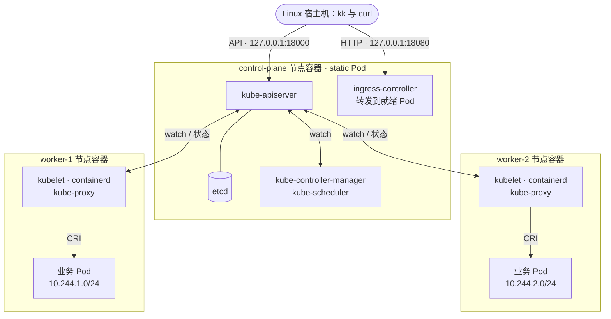

# mini-k8s

[English](README.md) | **简体中文**

mini-k8s 是一个用 Go 从零实现的精简版 Kubernetes。它自研 API Server、调度器、
Controller Manager、kubelet、kube-proxy、CNI 插件、Ingress 控制器和命令行工具 **`kk`**，只复用 etcd 做存储、
containerd 做容器运行时，并用本地 Docker Engine 承载集群的“机器”。

目标是“精简但五脏俱全”：用尽量少的代码把 Kubernetes 的核心机制完整、可观察地跑起来，
包括声明式 API、Watch、控制循环、调度、节点代理和级联删除。它不是现成发行版的封装，
不兼容 `kubectl`，也不适用于生产环境。

## 主要能力

- **K8s 风格 API**：`/api/v1/namespaces/{ns}/pods`、`/apis/apps/v1/...`，
  资源对象包含 `metadata`/`spec`/`status`，错误以 `Status` 对象返回，并提供 discovery 接口。
- **API 机制**：命名空间；UID 与 `resourceVersion` 乐观并发；`generation`/`observedGeneration`；
  `generateName`；严格解码（未知字段直接报错）；JSON merge patch；`dryRun`；
  label/field selector；**Watch**（etcd watch 流式推送，selector 变化时转为 DELETED 事件）。
- **删除语义**：finalizer；Pod 优雅终止（SIGTERM，宽限期后 SIGKILL）；强制删除；
  ownerReferences 与垃圾回收（Background / Foreground / Orphan 三种传播策略）；
  删除 Namespace 时级联清空其中的资源。
- **控制面**：Informer + WorkQueue 事件驱动；Deployment 与 ReplicaSet 控制器（RollingUpdate 按
  `maxSurge`/`maxUnavailable` 滚动或 Recreate、修订历史、回滚、暂停/恢复、带进度期限的
  Available/Progressing 条件）；Endpoints 控制器；GC 控制器；Namespace 控制器；Pod 垃圾回收
  （绑定在已删除节点上的 Pod 被标为失败并删除）。
- **调度器**：kube-scheduler 式框架。Filter 插件检查节点是否被 cordon、污点、`nodeSelector` 与节点亲和、
  资源请求是否超出 allocatable、Pod 亲和/反亲和；Score 插件（权重同 kube-scheduler）偏好分配最少的节点、
  打散同一 controller 的副本、遵循偏好亲和与 PreferNoSchedule 污点。不可调度的 Pod 带 kube-scheduler 的信息
  （`0/3 nodes are available: 2 Insufficient cpu, …`），退避后在集群事件发生时重试；经 binding 子资源绑定。
- **节点生命周期**：kubelet 在 `kube-node-lease` 中续约 Lease；续约停止时，节点生命周期控制器把节点标为
  Unknown、打上 `node.kubernetes.io/unreachable` 污点，并把其上的 Pod 从 Service 中摘除；污点驱逐控制器在
  `tolerationSeconds` 用尽后驱逐 Pod（每个 Pod 都带默认容忍，默认 300 秒）；不被容忍的 NoExecute 污点立即驱逐；
  `pods/eviction` 子资源与 `kk cordon/uncordon/drain/taint` 用于维护节点。
- **像 kubeadm 一样自托管**：etcd、kube-apiserver、kube-controller-manager、kube-scheduler 与
  Ingress 控制器都是 `control-plane` 节点上的 **static Pod**，kube-proxy 是每个节点上的 static Pod，
  它们都以 mirror Pod 的形式出现在 `kube-system` 中；control-plane 节点带污点，业务 Pod 只调度到
  worker；组件崩溃后由 kubelet 重启。
- **kind 式节点**：每个节点是一个运行自己 containerd 的特权容器；kubelet 通过 **CRI**
  管理 Pod（每个 Pod 先建沙箱，再建容器）；只有运行时、Pod 网络和沙箱镜像都就绪时节点才 Ready。
  `kk cluster up --workers N` 运行 1 到 10 个 worker；被移除的 worker 先 drain。
- **Pod**：多个容器共享同一网络命名空间；init 容器按顺序逐个运行至成功；`restartPolicy`
  Always/OnFailure/Never，终态 Succeeded/Failed 与 Initialized/ContainersReady/Ready 条件按
  Kubernetes kubelet 的规则计算；liveness、readiness、startup 探针（httpGet、tcpSocket、exec）；
  CPU 与内存的 requests/limits 经 cgroup 生效（超限 `OOMKilled`）及 QoS 等级；`emptyDir`（磁盘或内存）与
  `hostPath` 卷；`hostNetwork`；`kk exec` 在容器内执行命令。
- **kubelet**：节点注册、Lease 续约与状态上报；从清单目录运行 static Pod 并维护 mirror Pod；每个 Pod 一个
  worker；带退避的重启（CrashLoopBackOff）；`imagePullPolicy` 与镜像拉取失败上报
  （ErrImagePull/ImagePullBackOff）；节点重启后重建沙箱；
  日志（支持 follow/tail/`--previous`）；清理孤儿沙箱；按 `dnsPolicy`/`dnsConfig` 生成 Pod 的
  resolv.conf，管理 `/etc/hosts`（`hostname`、`subdomain`），并注入 Service 环境变量（`WEB_SERVICE_HOST` 等）。
- **Pod 网络**：node IPAM 控制器从 `10.244.0.0/16` 为每个节点分配一个 `/24`；自研 CNI 插件
  （`mini-cni`：网桥、veth、IP 分配）为每个 Pod 接网；host-gw 路由代理打通各节点的 Pod 子网，
  Pod 跨节点互访不经过 NAT；Pod 经所在节点解析域名、访问集群外部。
- **Service**：API Server 从 `10.96.0.0/12` 分配 ClusterIP、从 `30000-32767` 分配 NodePort；
  Endpoints 控制器维护就绪与未就绪的 Pod（支持命名 targetPort、多端口）；**kube-proxy** 与真实
  kube-proxy 的 iptables 模式一致（`KUBE-SERVICES` → `KUBE-SVC-*` → `KUBE-SEP-*`，随机均衡、
  ClientIP 会话亲和、NodePort 与 hairpin 流量做地址伪装、无端点时立即拒绝）；NodePort 在每个节点上可访问；
  支持 headless 与 ExternalName Service；API Server 维护 `kubernetes` Service，Pod 经它访问 API。
- **集群 DNS**：自研 DNS 服务器（`kube-dns`，地址 `10.96.0.10`，相当于 CoreDNS 的角色）应答
  `<svc>.<ns>.svc.cluster.local`、按 hostname 解析 headless 端点、SRV 记录、ExternalName 的 CNAME 与
  Pod 记录，其余名字转发给节点的解析器。
- **Ingress**：Ingress 控制器在 `127.0.0.1:18080` 按 host（精确或通配）与 path（Exact 或 Prefix）
  把请求转发到 Service 的就绪端点，支持默认后端、404/503 响应，并把地址写入 Ingress 状态。
- **可观测性**：Events（同类事件聚合计数，1 小时后由 etcd lease 自动过期），
  `kk describe` 会展示对象关联的事件。
- **kk**：`get`（`-o wide|json|yaml|name`、`-l`、`--field-selector`、`-A`、`-w`）、`describe`、
  `apply`/`create`（先整体 dry-run 再写入）、`delete`（`--grace-period`、`--force`、
  `--cascade`）、`logs -f/-p/-c`、`exec`、`scale`、`rollout status|history|undo|pause|resume|restart`、`cordon`/`uncordon`/`drain`/`taint`、`label`、`api-resources`、`version`、集群生命周期命令，
  以及 `image load`（把本地镜像导入各节点）。



图例：

- 每个方框是一个扮演“机器”的特权 Docker 容器，它们共享 Docker 网络 `mini-k8s`。默认两个 worker；
  `kk cluster up --workers N` 会增加 worker-3 及以后的节点（或只保留 worker-1）。
- control-plane 节点的 kubelet 以 static Pod 运行 etcd、API Server、Controller Manager、调度器和
  Ingress 控制器；该节点的污点让业务 Pod 只调度到 worker。每个节点（包括 control-plane）都运行 kube-proxy；
  集群 DNS（`kube-dns`，`10.96.0.10`）以普通 Pod 运行在 worker 上。
- 组件之间的箭头是 API 流量：各组件 list/watch API Server 并写回状态，只有 API Server 访问 etcd；
  kubelet 经 containerd（CRI）启动 Pod。
- Ingress 控制器把 `127.0.0.1:18080` 上的请求直接转发给各 worker 上就绪的 Pod。不同节点上的 Pod 经 host-gw
  路由直接互访；ClusterIP（`10.96.0.0/12`）只以 kube-proxy 的 iptables 规则存在于每个节点中，
  NodePort 在每个节点的地址上应答。

所有组件都是同一个二进制 `mini` 的不同角色。Docker Compose 只启动节点容器（与
[kind](https://kind.sigs.k8s.io) 的节点相同）；与 kubeadm 一样，每个 kubelet 在 API 还不存在时就从清单目录拉起
自己的 static Pod（[build/manifests/control-plane](build/manifests/control-plane)，worker 上是
[build/manifests/node](build/manifests/node)）。Pod 运行在节点内的 containerd 中，因此宿主机的
`docker ps` 只能看到这些节点。

## 自研与复用的组件

mini-k8s 的分工与 Kubernetes 项目本身一致：Kubernetes 自己实现的部分在这里全部自研；
Kubernetes 交给外部项目的部分（存储、容器运行时）直接使用开源组件，只写配置，不改代码。

**自研**（Go，均在本仓库中）：

| 组件 | 职责 | 状态 |
| --- | --- | --- |
| kube-apiserver | K8s 风格 REST、Watch、准入与校验、删除语义、子资源、ClusterIP 与 NodePort 分配 | 已实现 |
| controller-manager | Deployment、ReplicaSet、Endpoints、垃圾回收、Namespace、node IPAM、节点生命周期与污点驱逐控制器 | 已实现，持续扩展 |
| scheduler | 调度框架：Filter 与 Score 插件（污点、节点亲和、资源适配、Pod 亲和/反亲和、打散）、退避队列、binding 绑定 | 已实现 |
| kubelet | 节点注册与心跳、static Pod 与 mirror Pod、基于 CRI 的 Pod 生命周期（客户端一侧，`pkg/kubelet/kuberuntime`）、探针、状态上报、优雅终止、日志、CNI 配置、节点本地 DNS 转发 | 已实现 |
| 客户端库 | 泛型 REST 客户端、Informer、WorkQueue、Event 记录器 | 已实现 |
| kube-proxy | iptables 模式：ClusterIP、NodePort、会话亲和、地址伪装；作为每个节点的 static Pod 运行（使用其 Ubuntu 镜像中的 iptables 工具） | 已实现 |
| Ingress 控制器 | networking.k8s.io/v1 Ingress：在 `127.0.0.1:18080` 按 host 与 path 转发到 Service 的端点（相当于 kind 中 ingress-nginx 的角色）；作为 control-plane 节点的 static Pod 运行 | 已实现 |
| static Pod 清单 | `build/manifests/control-plane` 与 `build/manifests/node`（与 kubeadm 相同） | 已实现 |
| `kk` | 命令行客户端、集群生命周期管理、镜像导入 | 已实现 |
| demo 应用 | 示例与测试用的 HTTP 服务；`mini fetch` 是给没有 shell 的镜像用的极简 HTTP 客户端 | 已实现 |
| `mini-cni` + host-gw 路由代理 | Pod 网络：网桥、veth、IP 分配、loopback、跨节点路由、出网地址伪装 | 已实现 |
| `mini node-init`、pause 镜像 | 节点容器的入口（cgroup 委派、生成 containerd 配置并启动，再运行 kubelet）；Pod 沙箱进程 | 已实现 |
| 集群 DNS | `mini cluster-dns`：Service、headless、SRV、ExternalName 与 Pod 记录，其余名字转发上游（自写 DNS 报文编解码）；以 `kube-dns` 插件运行，相当于 CoreDNS 的角色 | 已实现 |

**直接使用的开源组件**：

| 组件 | 用途 | 状态 |
| --- | --- | --- |
| [etcd](https://etcd.io) v3.5.17 | 唯一的状态存储（通过 v3 JSON gateway 访问）；作为 control-plane 节点的 static Pod 运行 | 已使用 |
| Docker Engine + Compose | 运行节点容器（相当于“机器”）；不直接运行 Pod 或控制面 | 已使用 |
| [containerd](https://containerd.io) + [runc](https://github.com/opencontainers/runc) | 节点内的容器运行时（Ubuntu 软件包）；containerd 内置的 CRI 插件是 CRI 服务端，kubelet 是客户端 | 已使用 |
| [crictl](https://github.com/kubernetes-sigs/cri-tools) | 节点镜像中的调试工具（`crictl ps`），e2e 测试也用它 | 已使用 |
| Ubuntu 24.04 基础镜像、iptables、iproute2 | 节点容器与 kube-proxy 镜像（iptables/conntrack 工具）的操作系统环境 | 已使用 |
| Linux 内核能力 | namespace、cgroup、netfilter、bridge、veth | 已使用 |

**Go 依赖**：`gopkg.in/yaml.v3`（解析清单）、`google.golang.org/grpc` 与 `k8s.io/cri-api`
（仅为 CRI 协议定义，不含实现）；测试使用 Ginkgo/Gomega。项目不依赖 client-go 或任何
Kubernetes 组件的实现代码。

## 环境要求

| 依赖 | 要求 |
| --- | --- |
| Go 1.26 或更新版本 | `go` 已加入 `PATH`。 |
| Docker Engine（Linux 容器） | Linux 上的本地 rootful Docker Engine，允许运行**特权**容器，且使用 **cgroup v2**（`stat -fc %T /sys/fs/cgroup` 输出 `cgroup2fs`）。 |
| Docker Compose v2 | `docker compose version` 可正常执行。 |
| `make`、`curl`、`tar` | 用于构建程序和获取 etcd。 |
| 本地 Docker 访问权限 | 当前用户能访问本地 Unix socket；不接受 TCP、SSH 或远程 Docker endpoint。 |
| 空闲端口 | API 使用 `127.0.0.1:18000`，Ingress 使用 `127.0.0.1:18080`。 |

| 环境 | 状态 |
| --- | --- |
| Ubuntu 24.04（WSL2，x86_64），WSL 内安装的原生 Docker Engine 29.9、Compose v5.6、Go 1.27 | ✅ 已完成端到端验证 |
| 其他使用 cgroup v2 的 Linux 发行版（x86_64/arm64）、rootful Docker | 预期可用，未逐一验证 |
| WSL2 + Docker Desktop 的 WSL 集成 | 未验证 |
| macOS + Docker Desktop | kind 式节点尚未验证（Docker Desktop 使用 cgroup v2 且允许特权容器）；组件测试依赖的 `bin/etcd` 是 Linux 二进制，在 macOS 上这些测试会自动跳过 |
| cgroup v1 主机、rootless Docker、原生 Windows | 不支持 |

在 WSL 中使用时，请把仓库 clone 到 WSL 的 Linux 文件系统（如 `~/`），不要放在 Windows
盘符挂载目录下：那里的构建慢得多，文件权限语义也不同。

首次运行需要联网：Go 模块（`proxy.golang.org`，可用 `GOPROXY` 指定镜像）、etcd 二进制
（`storage.googleapis.com`），以及构建节点镜像所需的 Docker Hub（`ubuntu:24.04`）、Ubuntu
软件源（containerd、runc、iptables、iproute2）和 GitHub（crictl）。之后的运行复用已缓存的镜像。
Pod 使用由 `kk` 导入节点的本地镜像，运行示例不需要从镜像仓库拉取。

每个 Docker Engine 只支持一套本项目集群：Compose 项目名、网络名、数据卷名和发布端口都是
固定的。在另一个目录重新 clone 并启动，接管的仍是同一套集群和同一份 etcd 数据（重置方法见
第 5 步）。宿主机构建架构必须与 Linux 容器架构一致。

> **仅用于可信的本地实验。** 节点容器以特权模式运行，具有较高的 Docker 主机权限。
> API 使用共享 bearer token，没有 TLS 或 RBAC。不要对外暴露，也不要运行不可信的工作负载。

## Quick Start

```sh
git clone https://github.com/cvvz/mini-k8s.git
cd mini-k8s
```

以下命令都在项目根目录执行。

### 1. 检查环境

```sh
go version
docker version
docker compose version
docker ps
```

### 2. 构建并启动集群

```sh
make build
./bin/kk cluster up
./bin/kk cluster status
```

`cluster up` 会构建组件、准备 etcd（首次运行时用宿主机 curl 从 `storage.googleapis.com`
下载 v3.5.17）、从 `build/images/` 构建五个镜像（组件、节点、pause、etcd、kube-proxy；节点镜像
首次构建约需一分钟）、启动节点容器（默认三个）、把镜像导入每个节点的 containerd（随后 control-plane 节点的
kubelet 以 static Pod 启动 etcd、API Server、Controller Manager、调度器和 Ingress 控制器，每个节点
启动 kube-proxy），之后最多等待两分钟，直到 API 健康、所有节点都有新鲜的 Ready 心跳，最后像 kubeadm
安装 CoreDNS 一样 apply 集群 DNS 插件（[build/manifests/addons](build/manifests/addons)）。

```text
API healthy
NAME            STATUS   ROLES           AGE   VERSION
control-plane   Ready    control-plane   20s   mini-kubelet/v2
worker-1        Ready    worker          20s   mini-kubelet/v2
worker-2        Ready    worker          20s   mini-kubelet/v2
```

`kk get nodes -o wide` 还会显示每个节点的地址和 `containerd://` 运行时；控制面像 kubeadm
集群一样可见：

```sh
./bin/kk get pods -n kube-system
./bin/kk logs -n kube-system kube-apiserver-control-plane
```

要增加或减少 worker，传入 `--workers N`（1 到 10）；之后的 `cluster up` 与 `cluster down` 沿用这个数量
（记录在 `.mini-k8s/workers` 中）：

```sh
./bin/kk cluster up --workers 3   # 增加 worker-3：worker-1 的副本，有自己的磁盘
./bin/kk cluster up --workers 2   # 先 drain worker-3，再删除它的容器、磁盘和 Node 对象
```

新增的 worker 定义在 `cluster up` 生成的 Compose 文件中（`.mini-k8s/compose.workers.yaml`，extends
`compose.yaml` 的 `worker-1`）。集群停止时缩容无法 drain：集群起来后删除这些 Node 对象，Pod 垃圾回收在
40 秒后删除留在其上的 Pod，由它们的控制器在别处重建。

### 3. 部署示例

```sh
./bin/kk apply -f examples/demo.yaml
./bin/kk get deployments,pods,services,endpoints,ingresses -o wide
curl -sS --fail --retry 20 --retry-delay 1 --retry-all-errors http://127.0.0.1:18080/
```

[示例](examples/demo.yaml)创建一个两副本的 Deployment、一个 Service 和一个 Ingress，容器带有
CPU/内存的 requests 与 limits 以及 readiness/liveness 探针。Pod 的地址来自所在节点的 Pod CIDR
（`10.244.x.y`，见 `-o wide`）；Service 从 `10.96.0.0/12` 获得 ClusterIP，其 Endpoints 列出就绪的
Pod；Ingress 控制器把 `127.0.0.1:18080` 上的请求轮询转发给它们，响应形如
`hello from web-997d7b744-f8shs`（Pod 名即主机名）。Pod 刚创建时可能短暂返回 `503`，
上面的 curl 会自动重试。

### 4. 观察与操作

```sh
export PATH="$PWD/bin:$PATH"             # 之后可直接使用 kk

kk get pods -w                           # 实时观察变化（Ctrl-C 退出）
kk describe deployment web               # 详情与关联事件
kk get events
kk logs -f POD_NAME                      # POD_NAME 换成 get pods 输出的名字
kk logs -p POD_NAME                      # 容器重启后查看上一个实例的日志
kk exec POD_NAME -- /mini fetch http://127.0.0.1:8080/   # 在 Pod 中执行命令
kk exec POD_NAME -- /mini fetch http://127.0.0.1:8080/fail-ready  # 让它的 readiness 探针失败：
kk get pods,endpoints                    # 约 2 秒后变为 0/1，该 Pod 移到 notReadyAddresses
kk exec POD_NAME -- /mini fetch http://127.0.0.1:8080/recover
kk exec POD_NAME -- /mini cat /sys/fs/cgroup/memory.max          # 64Mi 的限制：67108864
kk get svc web                           # CLUSTER-IP 可以从任意 Pod 和节点访问：
kk exec POD_NAME -- /mini fetch http://CLUSTER_IP/               # kube-proxy 选择一个就绪 Pod
docker exec mini-k8s-worker-1-1 iptables -t nat -S KUBE-SERVICES # 背后的 iptables 规则
kk exec POD_NAME -- /mini lookup web     # 集群 DNS：web.default.svc.cluster.local
kk exec POD_NAME -- /mini cat /etc/resolv.conf                   # 搜索域与 ndots:5
kk exec POD_NAME -- /mini fetch http://kubernetes.default.svc:443/healthz   # 在 Pod 内访问 API
kk scale deployment web --replicas 3
kk rollout restart deployment/web        # 一次滚动更新：新建 ReplicaSet，逐个替换 Pod
kk rollout status deployment/web         # 等待完成
kk get replicasets                       # 旧 ReplicaSet 缩到 0 后保留，用于回滚
kk rollout history deployment/web
kk rollout undo deployment/web           # 回到上一个版本
kk delete pod POD_NAME                   # 优雅终止，Deployment 会补建新 Pod
kk delete pod POD_NAME --force           # 立即从 API 删除
kk get leases -n kube-node-lease         # 每个 kubelet 每 2 秒续约一次 Lease
kk drain worker-2                        # cordon worker-2，并把其上的 Pod 迁到 worker-1
kk get pods -o wide                      # web 的 Pod 现在都在 worker-1 上
kk uncordon worker-2
kk taint nodes worker-2 dedicated=demo:NoExecute   # 驱逐不容忍该污点的 Pod
kk taint nodes worker-2 dedicated-                  # 再去掉它
kk label nodes worker-2 disk=ssd         # 带 nodeSelector disk: ssd 的 Pod 会调度到 worker-2
kk scale deployment web --replicas 4     # 副本被打散：每个 worker 两个

kk create namespace team
kk apply -n team -f examples/hello.yaml  # 在另一个命名空间部署，用 NodePort Service 暴露
kk get svc -n team hello                 # PORT(S) 显示 80:NODE_PORT/TCP
kk get nodes -o wide                     # 在宿主机上 curl http://节点INTERNAL-IP:NODE_PORT/
kk get pods -A                           # 跨命名空间查看
kk delete namespace team                 # 级联删除其中所有资源

kk apply -f examples/init-and-sidecar.yaml   # init 容器 + 共享网络与卷的两个容器
kk get pod web-with-sidecar              # 先 Init:0/1，之后 2/2 Running
kk exec web-with-sidecar -c sidecar -- /mini fetch http://127.0.0.1:8080/
kk exec web-with-sidecar -c sidecar -- /mini write /shared/note "written by the sidecar"
kk exec web-with-sidecar -c web -- /mini cat /shared/note

docker exec mini-k8s-worker-1-1 crictl ps    # 像登录真实机器一样查看节点内部
```

Pod 运行在节点内部，所以要运行自己的镜像，需要先用 Docker 构建，再导入各节点
（与 `kind load docker-image` 相同），使用它的 Pod 不需要镜像仓库：

```sh
docker build -t my-app:v1 PATH_TO_YOUR_APP
kk image load my-app:v1
```

### 5. 停止集群

```sh
./bin/kk cluster down
```

该命令先停止 worker，再停止 control-plane 节点（节点上的 Pod，包括控制面，随之停止）并删除容器，
**保留 etcd 数据（位于 control-plane 节点的磁盘上）、节点磁盘和 token**。之后执行 `cluster up` 会恢复保存的资源，kubelet 会重建各自的 Pod。
若想彻底移除示例，先执行 `kk delete -f examples/demo.yaml` 再停止集群。

若要**从零开始**（丢弃集群中的所有资源以及导入节点的镜像），同时删除数据卷：

```sh
./bin/kk cluster down --volumes
./bin/kk cluster up
```

## 支持范围

| 资源 | apiVersion | 支持的字段与行为 |
| --- | --- | --- |
| Namespace | `v1` | 创建、删除（Terminating → 清空内容 → 删除）。启动时自动创建 `default`、`kube-system`。 |
| Node | `v1` | 由 kubelet 注册，上报 `capacity`/`allocatable`（cpu、memory、pods）与角色标签；`spec.podCIDR` 由 node IPAM 一次性分配；调度器与污点驱逐控制器遵守 `spec.unschedulable` 与 `spec.taints`（NoSchedule、PreferNoSchedule、带 `timeAdded` 的 NoExecute）；control-plane 节点带污点 `node-role.kubernetes.io/control-plane:NoSchedule`；失联节点变为 `Unknown` 并带 `node.kubernetes.io/unreachable` 污点。 |
| Lease | `coordination.k8s.io/v1` | `holderIdentity`、`leaseDurationSeconds`、`renewTime`；每个 kubelet 续约 `kube-node-lease/<节点名>`。 |
| Pod | `v1` | `containers`（一个或多个）与 `initContainers`：`name`、`image`、`command`、`args`、`env`、`ports`、`resources`（cpu、memory）、`livenessProbe`/`readinessProbe`/`startupProbe`（init 容器不可用）、`volumeMounts`；`volumes`（`emptyDir` 支持 `medium`/`sizeLimit`，`hostPath` 支持 `type`）；`hostNetwork`；`hostname`、`subdomain`；`dnsPolicy`（ClusterFirst、ClusterFirstWithHostNet、Default、None）与 `dnsConfig`；`enableServiceLinks`；`tolerations`；`nodeSelector`；`affinity`（`nodeAffinity`、`podAffinity`、`podAntiAffinity`，required 与 preferred，`topologyKey`）；调度时计入 `resources.requests`；`imagePullPolicy`（Always、IfNotPresent、Never，默认值同 Kubernetes）；`restartPolicy`（Always、OnFailure、Never）；`terminationGracePeriodSeconds`；`nodeName`。创建后 spec 不可变。static Pod 以 mirror Pod 呈现（只读；删除后 kubelet 会重建）。子资源 `log` 与 `exec`。 |
| Deployment | `apps/v1` | `replicas`（默认 1）、`selector`（matchLabels/matchExpressions，创建后不可变）、`template`（`restartPolicy` 必须为 Always）、`strategy`（RollingUpdate 的 `maxSurge`/`maxUnavailable` 默认各 25%，或 Recreate）、`minReadySeconds`、`revisionHistoryLimit`（10）、`paused`、`progressDeadlineSeconds`（600）。每个模板版本对应一个 ReplicaSet；注解 `deployment.kubernetes.io/revision` 与 `kubernetes.io/change-cause`。 |
| ReplicaSet | `apps/v1` | `replicas`、`selector`（不可变）、`template`、`minReadySeconds`；通常由 Deployment 管理。 |
| Service | `v1` | `type` 为 ClusterIP（默认）、NodePort 或 ExternalName（`externalName`）；`selector`（可省略：此时由用户自己写 Endpoints）；`ports`（`name`、`port`、`targetPort` 为数字或容器端口名、`protocol` TCP/UDP、`nodePort` 取自 30000-32767）；`clusterIP`（未指定时从 `10.96.0.0/12` 分配，`None` 表示 headless，创建后不可变）；`publishNotReadyAddresses`；`sessionAffinity` None/ClientIP 及 `sessionAffinityConfig.clientIP.timeoutSeconds`。`default/kubernetes`（`10.96.0.1`，`443/TCP`）由 API Server 维护。 |
| Endpoints | `v1` | 对有选择器的 Service 由 Endpoints 控制器维护：`subsets` 中的 `addresses`（就绪）与 `notReadyAddresses`（带 `nodeName`/`targetRef`），`ports` 以 Service 端口命名。 |
| Ingress | `networking.k8s.io/v1` | `rules`（`host` 为精确名或 `*.domain`；`http.paths` 的 `path`、`pathType` Exact/Prefix/ImplementationSpecific、`backend.service` 的名称与端口号或端口名）、`defaultBackend`、`ingressClassName`（未设置或 `mini`）；状态中报告 `localhost`。不支持 TLS。 |
| Event | `v1` | 由组件记录，可查询；1 小时后过期。 |

`kk apply` 采用 JSON merge patch：清单里的字段会覆盖服务端的值，**从清单中删掉的字段不会
从服务端删除**（没有 last-applied 三方合并）。批量应用前会对所有文档做服务端 dry-run，
所以任何一个文档有误都不会改动集群；但真正写入时仍不是跨资源事务。

## 当前限制（后续里程碑会解决）

- 还没有 ConfigMap、Secret 和持久卷（M8）；不支持 `subPath` 与 `hostPort`。`kk exec` 把命令执行完再返回输出，
  不支持交互式会话（stdin/tty），与 Kubernetes 的流式 exec 不同。
- 滚动更新过程中修改 `replicas` 不做按比例扩缩；ReplicaSet 不收养孤儿 Pod。`kk apply` 是 merge patch：
  把 Deployment 改成 `Recreate` 时需要在清单中写 `rollingUpdate: null`。
- 不支持 LoadBalancer 类型、EndpointSlice、`externalTrafficPolicy` 和 IPv6（AAAA 查询返回空应答）；
  集群 DNS 没有缓存和反向（PTR）记录。NodePort 与 kind 一样从 Linux 宿主机经节点地址访问，不在 `127.0.0.1`
  上发布。API、`kubernetes` Service（443 端口）与 Ingress 控制器都是明文 HTTP；没有 ServiceAccount，DNS 插件
  从所在节点读取 API token。
- 调度器没有抢占、优先级与 `topologySpreadConstraints`（副本默认打散）；没有 PodDisruptionBudget（驱逐总是成功）。心跳比 Kubernetes
  默认值快：每 2 秒续约 Lease，15 秒没有续约的节点即为 Unknown。
- 一个 control-plane 节点（无高可用），最多 10 个 worker；节点是共享宿主机内核的容器。e2e 套件要求默认的两个 worker。
- 没有 DaemonSet、Job、CronJob、StatefulSet、HPA、RBAC 和控制面高可用。

## 开发与测试

```sh
make vet
make test                # 单元测试 + 组件测试（使用 bin/etcd 启动临时 etcd）
go test -race ./...
```

集成测试（`test/integration`，以及各包中使用 `test/integration/framework` 的测试）会在进程内
启动真实的 API Server，后端是临时 etcd。etcd 二进制取自 `bin/etcd`（`make prepare-etcd` 准备）；
缺失时这些测试自动跳过。

端到端测试是仿照 Kubernetes `test/e2e` 的 Ginkgo v2 套件（见
[test/e2e/README.md](test/e2e/README.md)），每个用例在独立命名空间中运行，结束后删除：

```sh
make e2e                          # 全部用例，包括 Disruptive 用例
make e2e-quick                    # 跳过 Disruptive 用例
make e2e E2E_FOCUS='sig-apps'     # 按名称运行子集
```

**只在可重建、使用默认两个 worker 的本项目实验集群上运行。** Disruptive 用例会重启 control-plane 节点、
一个控制面组件和一个 worker，停止一个 worker 约一分钟，对 worker 执行 cordon、drain 与 taint，清空某个节点上
kube-proxy 的规则，执行 `cluster down/up`，并扩到三个 worker 再缩回。用例使用各自的命名空间和 Ingress host，Quick Start 部署的示例可以保留。

每个新功能都必须附带 e2e 用例。

## 常见问题

| 现象 | 检查方式 |
| --- | --- |
| 找不到 `go`、`docker` 或 `make` | 安装依赖并加入 `PATH`。 |
| Docker 命令挂起 | 检查实际引擎（例如 `systemctl status docker`），重启前确认对其他工作负载的影响。 |
| etcd 下载失败 | 检查访问 `storage.googleapis.com` 的网络或代理；也可在 `bin/etcd` 预置 Linux etcd v3.5.17。 |
| 节点镜像构建在 `apt-get` 或下载 crictl 时失败 | 节点镜像首次构建需要访问 Docker Hub、Ubuntu 软件源和 GitHub；重试或配置代理/镜像源。 |
| 节点容器启动即退出并报 cgroup 错误 | 宿主机必须使用 cgroup v2，并允许特权容器。 |
| `cluster up` 后 `kk` 连不上 API | 控制面运行在 control-plane 节点内：`docker logs mini-k8s-control-plane-1` 查看其 kubelet，`docker exec mini-k8s-control-plane-1 crictl ps -a` 查看 static Pod，`docker exec mini-k8s-control-plane-1 crictl logs CONTAINER` 查看其输出。 |
| 节点一直 `NotReady` | `Unknown` 且信息为 `Kubelet stopped posting node status.` 表示 kubelet 停止了续约（节点容器已停止：`docker ps -a`）；否则 `kk describe node NAME` 显示原因（运行时、网络插件或沙箱镜像未就绪）；`docker logs mini-k8s-worker-1-1` 查看 containerd 与 kubelet 输出；`docker exec mini-k8s-worker-1-1 crictl pods` 列出沙箱。 |
| Pod 显示 `ErrImagePull`/`ImagePullBackOff` | `kk describe pod NAME` 查看事件。节点会自己拉取公开镜像；本地或私有镜像需要用 `kk image load IMAGE` 导入。 |
| Pod 显示 `CreatePodSandboxError` | 错误信息来自 containerd 和 CNI 插件；按上一行的方法查看节点日志。 |
| Pod 显示 `CrashLoopBackOff` | `kk logs NAME` 查看应用日志，`kk logs -p NAME` 查看上一次运行的日志；kubelet 以 1s 起、最长 30s 的退避重启。 |
| `127.0.0.1:18080` 返回 `503` | Service 没有就绪端点：`kk get endpoints NAME`（未就绪的 Pod 不显示在 ENDPOINTS 列中）；检查 selector 与 `targetPort`。`404 default backend` 表示没有与 host 和 path 匹配的 Ingress 规则。 |
| Pod 内解析不到 Service 名字 | `kk get pods -n kube-system -l k8s-app=kube-dns`（应有两个 Running）、`kk logs -n kube-system POD`，以及 `kk exec POD -- /mini cat /etc/resolv.conf`（除非 `dnsPolicy` 另有设置，nameserver 应为 `10.96.0.10`）。`kk exec POD -- /mini lookup NAME` 显示 Pod 的解析结果。 |
| ClusterIP 或 NodePort 无响应 | `kk get pods -n kube-system`（每个节点都要有 kube-proxy）、`kk logs -n kube-system kube-proxy-worker-1`，以及 `docker exec mini-k8s-worker-1-1 iptables -t nat -S` 查看规则。`connection refused` 表示 Service 没有就绪端点。 |
| `Error from server (Invalid)` | 按报错中的字段路径修改清单；未知字段同样会被拒绝。 |
| 端口或项目名冲突 | 释放端口或停止冲突项目；只修改 `MINI_API` 不会改变 Compose 端口映射。 |
| 新 clone 的集群里有旧资源 | 同一个 Docker Engine 上只有一套集群和一组节点磁盘（etcd 位于 control-plane 节点的磁盘上）；按第 5 步用 `kk cluster down --volumes` 重置。 |
| 从控制面独立运行在容器中的旧版本升级 | etcd 数据已移到 control-plane 节点上：先 `kk cluster down --volumes`，再 `docker volume rm mini-k8s_etcd-data`，然后 `kk cluster up`。 |

首次启动会生成权限为 `0600` 的 `.mini-k8s/token`，不要泄露或在集群运行中删除。
手动使用 Compose 排障时需要设置 `kk` 通常会自动提供的环境变量（不要打印 token）：

```sh
export MINI_TOKEN="$(cat .mini-k8s/token)"
docker compose ps
docker compose logs --tail=100 control-plane
unset MINI_TOKEN
```

仅在确认是 Docker 凭据助手挂起时，可尝试 `MINI_DOCKER_NO_CREDENTIALS=1 ./bin/kk cluster up`。
它使用临时匿名 Docker 配置，不修改现有配置。

## 路线图

| 里程碑 | 内容 | 状态 |
| --- | --- | --- |
| M0 | 工程基线、Linux 文档 | ✅ |
| E2E | Ginkgo e2e 框架 | ✅ |
| M1 | API 机制：K8s 风格 REST、Namespace、Watch、Informer/WorkQueue、GC、优雅删除、Events | ✅ |
| M2 | kind 式节点：节点内 containerd、kubelet 经 CRI 管理 Pod、自研 CNI（host-gw 跨节点路由） | ✅ |
| M3a | Pod：多容器、init 容器、重启策略与终态、`kk exec` | ✅ |
| M3b | Pod：liveness/readiness/startup 探针、资源 requests 与 limits、QoS、节点容量 | ✅ |
| M3c | Pod：卷（emptyDir、hostPath）、hostNetwork | ✅ |
| M4 | 控制面自托管：control-plane 节点、static/mirror Pod，etcd 与控制面组件运行在 kube-system，污点与容忍 | ✅ |
| M5 | ReplicaSet、滚动更新与回滚、`kk rollout` | ✅ |
| M6a | ClusterIP 与 NodePort Service、Endpoints、iptables kube-proxy、Ingress | ✅ |
| M6b | 集群 DNS、headless 与 ExternalName Service、`kubernetes` Service、Pod 的 DNS 配置与 Service 环境变量 | ✅ |
| M7a | 节点租约与生命周期、基于污点的驱逐、Eviction API、cordon/drain/taint | ✅ |
| M7b | 调度框架：资源适配、nodeSelector 与亲和性、Pod 亲和/反亲和、打散 | ✅ |
| M7c | 更多 worker（`kk cluster up --workers N`）、Pod 垃圾回收 | ✅ |
| M8 | ConfigMap、Secret、卷、PVC | 计划中 |
| M9 | DaemonSet、Job、CronJob、StatefulSet | 计划中 |

## 设计文档

- [v2 设计规格](docs/superpowers/specs/2026-10-14-mini-k8s-v2-design.md)：整体架构与里程碑。
- [M7c worker 扩缩计划](docs/superpowers/plans/2026-10-15-m7c-worker-scaling.md)
- [M7b 调度框架计划](docs/superpowers/plans/2026-10-15-m7b-scheduling-framework.md)
- [M7a 节点生命周期计划](docs/superpowers/plans/2026-10-15-m7a-node-lifecycle.md)
- [M6b 集群 DNS 计划](docs/superpowers/plans/2026-10-15-m6b-cluster-dns.md)
- [M6a Service、kube-proxy 与 Ingress 计划](docs/superpowers/plans/2026-10-15-m6a-services-kube-proxy-ingress.md)
- [M5 ReplicaSet 与滚动更新计划](docs/superpowers/plans/2026-10-15-m5-replicaset-rollout.md)
- [M4 控制面自托管计划](docs/superpowers/plans/2026-10-15-m4-self-hosted-control-plane.md)
- [M3c 卷与主机网络计划](docs/superpowers/plans/2026-10-15-m3c-volumes-hostnetwork.md)
- [M3b 探针与资源计划](docs/superpowers/plans/2026-10-15-m3b-probes-resources.md)
- [M3a 多容器 Pod 计划](docs/superpowers/plans/2026-10-15-m3a-multi-container.md)
- [M2 kind 式节点计划](docs/superpowers/plans/2026-10-15-m2-kind-nodes.md)
- [M1 API 机制计划](docs/superpowers/plans/2026-10-14-m1-api-machinery.md)
- [kind 式节点可行性验证](docs/superpowers/spikes/2026-10-15-kind-node-spike.md)：节点内 containerd、CRI、host-gw 跨节点网络的实测配方
- [M0 工程基线计划](docs/superpowers/plans/2026-10-14-m0-baseline.md)
- [v1 设计规格](docs/superpowers/specs/2026-10-14-mini-k8s-design.md) 与
  [v1 实施计划](docs/superpowers/plans/2026-10-14-mini-k8s-plan.md)：最初 30 分钟版本的记录。
